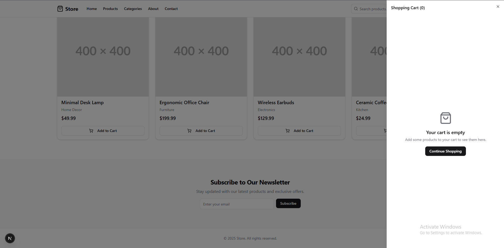
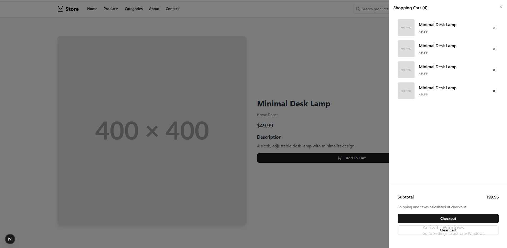
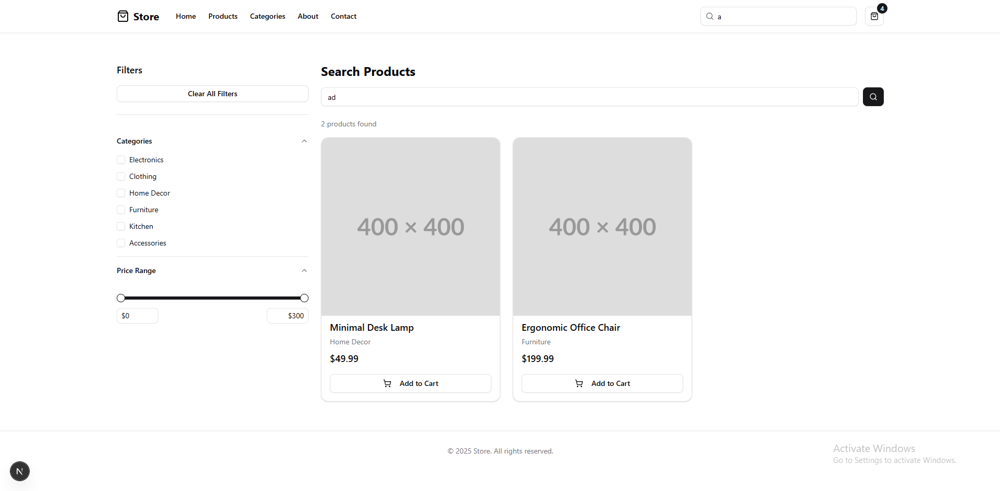

# Modern E-Commerce Store

A clean, modern e-commerce website built with Next.js, Tailwind CSS, and shadcn/ui components. This project features a minimalist design focused on user experience and performance.

## 🎯 Screens

### Cart:



### Product Page With Cart:



### Search Page:



## 🚀 Features

### Core Functionality
- **Product Catalog**: Browse products with detailed information and images
- **Advanced Search**: Full-text search with filtering by category and price range
- **Shopping Cart**: Add/remove items with persistent storage using localStorage
- **Checkout Flow**: Multi-step checkout process with shipping and payment forms
- **Responsive Design**: Optimized for mobile, tablet, and desktop devices

### User Interface
- **Clean Design**: Minimalist aesthetic with focus on product presentation
- **shadcn/ui Components**: Consistent, accessible UI components
- **Mobile-First**: Responsive design that works seamlessly across all devices
- **Loading States**: Smooth transitions and loading indicators

### Technical Features
- **Next.js App Router**: Modern routing with file-based navigation
- **TypeScript**: Full type safety throughout the application
- **Form Validation**: Robust form handling with React Hook Form and Zod
- **State Management**: React Context for cart management
- **Performance Optimized**: Image optimization and efficient rendering

## 🛠️ Tech Stack

- **Framework**: [Next.js 15](https://nextjs.org/) with App Router
- **Styling**: [Tailwind CSS](https://tailwindcss.com/)
- **UI Components**: [shadcn/ui](https://ui.shadcn.com/)
- **Icons**: [Lucide React](https://lucide.dev/)
- **Language**: [TypeScript](https://www.typescriptlang.org/)

## 📦 Installation

### Prerequisites
- Node.js 18+ 
- npm, yarn, or pnpm

### Setup Instructions

1. **Clone or download the project**
   ```bash
   # If using git
   git clone https://github.com/Mo-Ibra/nextjs-clean-ecommerce
   cd nextjs-clean-ecommerce
   ```

2. **Install dependencies**
   ```bash
   npm install
   # or
   yarn install
   # or
   pnpm install
   ```

3. **Run the development server**
   ```bash
   npm run dev
   # or
   yarn dev
   # or
   pnpm dev
   ```

4. **Open your browser**
   Navigate to [http://localhost:3000](http://localhost:3000) to see the application.

### Backend API

Start the backend from `Nardishop_backend` on port `5000` before using live catalog, authentication, cart, or account checkout features. The frontend proxies `/api/*` and `/uploads/*` to `http://localhost:5000` by default. Set `BACKEND_API_URL` in the frontend environment to use a different backend origin.

- Products, login, registration, and password recovery use the corresponding `/api` endpoints.
- Administrators are redirected to `/admin` after login, where they can upload and delete products. Product uploads are sent as multipart form data and require an administrator account.
- The Categories page and search filters include categories selected when products are created; category detail pages list products assigned to those categories.
- Guest cart and guest checkout remain browser-local. A logged-in cart and order checkout use the authenticated backend routes.
- Product creation includes a category selected from the categories configured in the frontend; the backend stores and returns it for category filtering.
- Password recovery currently depends on the backend's reset-token flow; it does not send email itself.

## 🎯 Key Pages

### Homepage (`/`)
- Hero section with call-to-action
- Featured product showcase
- Category navigation
- Newsletter signup

### Products (`/products`)
- Complete product listing
- Product cards with images and pricing
- Links to individual product pages

### Product Detail (`/products/[id]`)
- Detailed product information
- High-quality product images
- Add to cart functionality
- Product specifications

### Search (`/search`)
- Advanced search functionality
- Category and price filtering
- Real-time results
- Mobile-friendly filter panel

### Checkout (Coming Soon) (`/checkout`)
- Multi-step checkout process
- Shipping information form
- Payment method selection
- Order confirmation

## 🛒 Cart Management

The shopping cart uses React Context for state management and localStorage for persistence:

- **Add to Cart**: Products can be added from product cards or detail pages
- **Remove Items**: Individual items can be removed from the cart
- **Persistent Storage**: Cart contents are saved between browser sessions
- **Real-time Updates**: Cart count updates immediately when items are added/removed

## 🔍 Search & Filtering

Advanced search functionality includes:

- **Text Search**: Search across product names and descriptions
- **Category Filtering**: Filter by product categories
- **Price Range**: Adjustable price range slider
- **Real-time Results**: Instant filtering as criteria change
- **Mobile Optimization**: Collapsible filter panel for mobile devices

## 📱 Responsive Design

The application is fully responsive with:

- **Mobile-First Approach**: Designed for mobile devices first
- **Breakpoint System**: Tailwind CSS responsive utilities
- **Touch-Friendly**: Optimized for touch interactions
- **Performance**: Optimized images and efficient rendering

## 🎨 Customization

### Styling
- Update `app/globals.css` for global styles
- shadcn/ui components can be customized in `components/ui/`

### Data
- Live product records are loaded from the backend API.
- Category presentation data remains in `lib/data.ts` because the current backend API has no category endpoint.

### Components
- All components are modular and reusable
- Located in `components/` directory
- Follow TypeScript interfaces defined in `lib/types.ts`

## 📊 Browser Support

- Chrome (latest)
- Firefox (latest)
- Safari (latest)
- Edge (latest)
- Mobile browsers (iOS Safari, Chrome Mobile)

---

**Built with using Next.js and modern web technologies**
